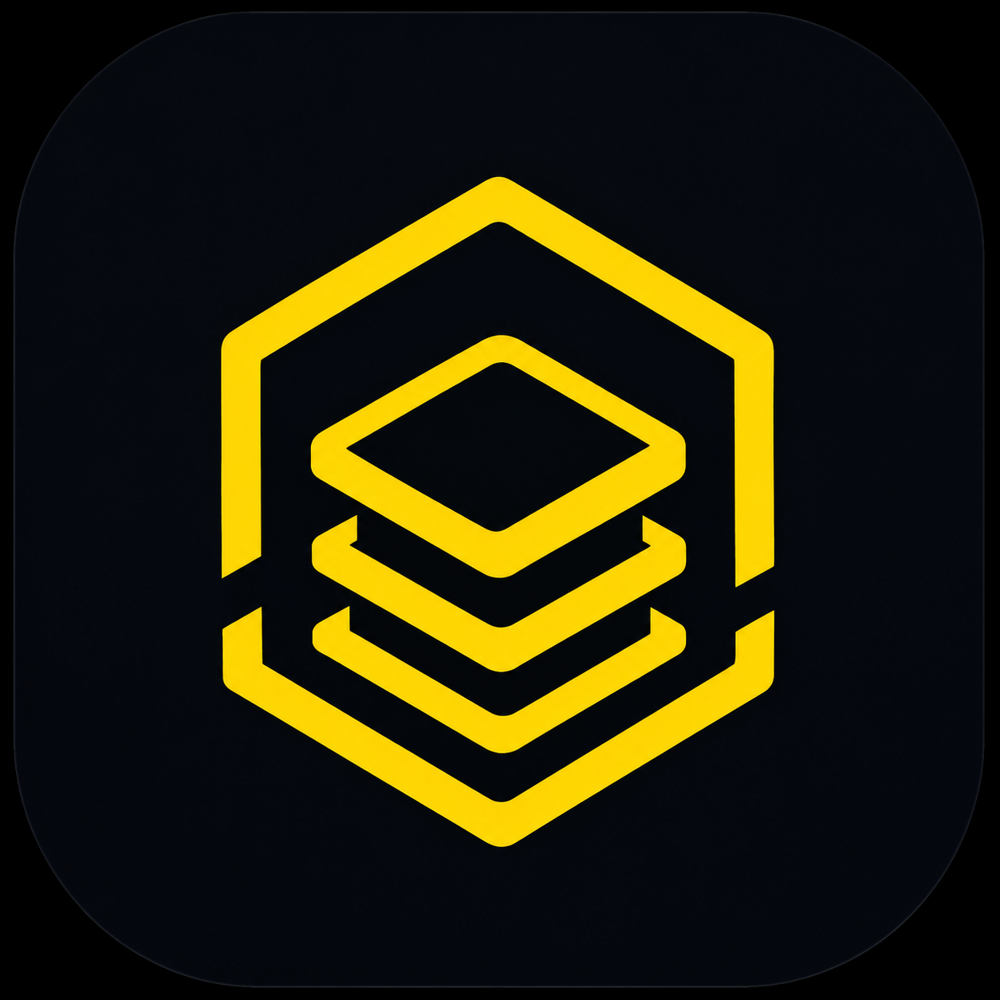
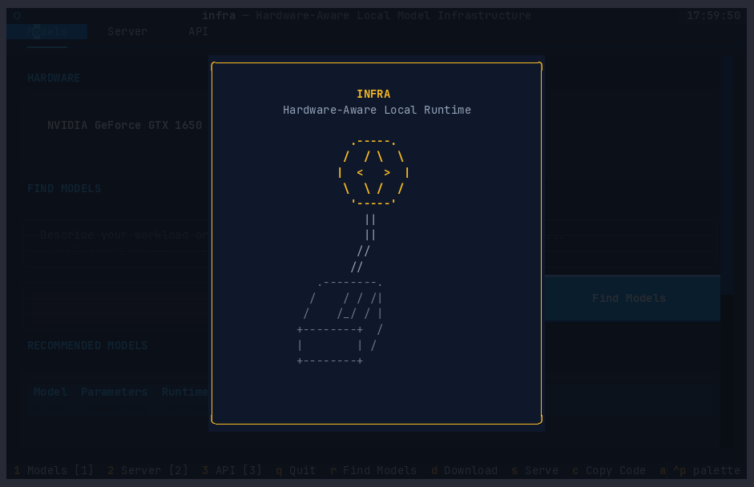
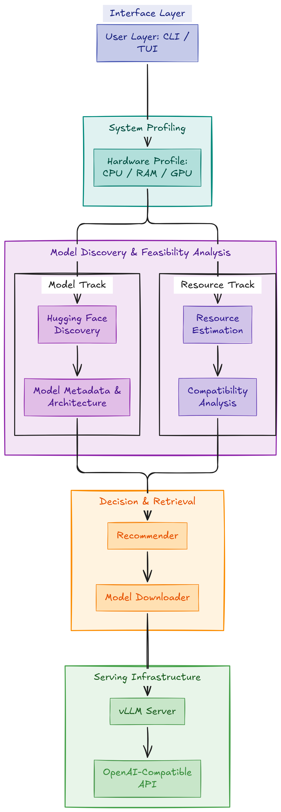

 <p align="center">
  
</p>

<h1 align="center">infra</h1>

<p align="center">
  <strong>Hardware-aware local AI model infrastructure.</strong>
  <br>
  Discover, evaluate, and deploy models based on your hardware.
</p>

<p align="center">
  
  
  
  
</p>

<p align="center">
  <a href="#features">Features</a> ·
  <a href="#installation">Installation</a> ·
  <a href="#quickstart">Quickstart</a> ·
  <a href="#api-usage">API</a> ·
  <a href="#architecture">Architecture</a>
</p>

---

## Overview

**Infra** is a hardware-aware infrastructure tool for discovering, evaluating, and deploying local AI models.

It inspects your system hardware, discovers models from Hugging Face, estimates memory requirements, evaluates hardware compatibility, and manages local vLLM deployments.

The goal is simple: help developers understand what their hardware can realistically run before downloading and deploying a model.

<p align="center">
  
</p>

## Features

### Hardware inspection
- CPU architecture, cores and threads
- System RAM and available memory
- GPU detection and VRAM information
- Storage capacity and available space

### Model discovery
- Dynamic Hugging Face Hub discovery
- Model architecture and metadata inspection
- Parameter count and context-length information
- Quantization metadata where available
- Cached metadata for repeat searches

### Hardware-aware recommendations
Discover and rank models according to workload and hardware compatibility.

Supported workloads:
- Coding
- Chat
- Reasoning
- Retrieval-Augmented Generation (RAG)
- Summarization
- General-purpose tasks

### Resource estimation
Estimate model deployment memory requirements.

| Resource | Description |
|---|---|
| Model weights | Parameter storage requirements |
| KV cache | Context-dependent memory requirements |
| Runtime overhead | Estimated backend overhead |
| Safety margin | Additional deployment headroom |

Supported precision options: `FP32`, `FP16`, `BF16`, `INT8`, `INT4`.

> Estimates are planning approximations. Actual memory usage depends on the model architecture, runtime, hardware and workload.

### Model downloading
- Download selected models from Hugging Face
- Use the Hugging Face cache
- Keep recommendation and downloading as separate operations

### vLLM server management
- Start local inference servers
- Configure context length and GPU memory utilization
- Inspect server status
- Stop managed server processes

### OpenAI-compatible API
Expose deployed models through an OpenAI-compatible API endpoint.

```text
http://127.0.0.1:8000/v1
```

Use local models from existing OpenAI-compatible clients and applications.

### Interactive TUI
A terminal dashboard built with Textual.

| Tab | Functionality |
|---|---|
| Models | Hardware information, discovery, recommendations and downloads |
| Server | Downloaded model listing and vLLM server management |
| API | Endpoint status and client examples |

---

## Installation

### Requirements

- Python `>=3.12, <3.13`
- Linux recommended for the current vLLM workflow
- Compatible hardware and runtime dependencies for vLLM

### Clone the repository

```bash
git clone https://github.com/Rktim/Infra.git
cd Infra
```

### Install dependencies

Using `uv`:

```bash
uv sync --dev
```

### Verify installation

```bash
uv run infra --help
```

---

## Quickstart

### 1. Inspect hardware and model requirements

```bash
uv run infra inspect Qwen/Qwen2.5-Coder-1.5B-Instruct \
  --context-length 1024
```

### 2. Discover and recommend models

```bash
uv run infra recommend \
  --use-case coding \
  --context-length 1024 \
  --max-models 5
```

Supported use cases:

```text
coding
chat
reasoning
rag
summarization
general
```

Recommendations use Hugging Face metadata. Model weights are not downloaded during this step.

### 3. Download a selected model

```bash
uv run infra download Qwen/Qwen2.5-Coder-1.5B-Instruct
```

### 4. Start the vLLM server

```bash
uv run infra serve Qwen/Qwen2.5-Coder-1.5B-Instruct \
  --context-length 1024 \
  --enforce-eager
```

If the preflight check reports that the estimated memory requirement exceeds the configured budget, `--force` allows you to proceed despite the warning.

```bash
uv run infra serve Qwen/Qwen2.5-Coder-1.5B-Instruct \
  --context-length 1024 \
  --enforce-eager \
  --force
```

### 5. Check server status

```bash
uv run infra status
```

### 6. Stop the server

```bash
uv run infra stop
```

### 7. Launch the interactive dashboard

```bash
uv run infra tui
```

---

## API Usage

Once the vLLM server is running, the API is available at:

```text
http://127.0.0.1:8000/v1
```

### cURL

```bash
curl http://127.0.0.1:8000/v1/chat/completions \
  -H "Content-Type: application/json" \
  -d '{
    "model": "Qwen/Qwen2.5-Coder-1.5B-Instruct",
    "messages": [
      {
        "role": "user",
        "content": "Explain Python decorators in one paragraph."
      }
    ],
    "max_tokens": 100,
    "temperature": 0.2
  }'
```

### Python

```python
from openai import OpenAI

client = OpenAI(
    base_url="http://127.0.0.1:8000/v1",
    api_key="not-needed",
)

response = client.chat.completions.create(
    model="Qwen/Qwen2.5-Coder-1.5B-Instruct",
    messages=[
        {
            "role": "user",
            "content": "Explain Python decorators.",
        }
    ],
    max_tokens=100,
    temperature=0.2,
)

print(response.choices[0].message.content)
```

---

## Architecture
 <p align="center">



</p>


## Technology Stack

| Technology | Purpose |
|---|---|
| Python | Core implementation |
| Hugging Face Hub | Model discovery and metadata |
| PyTorch | Model runtime |
| Transformers | Model architecture support |
| vLLM | Inference and serving |
| Textual | Terminal interface |
| psutil | System information |
| pytest | Testing |
| uv | Environment and dependency management |

---

## Testing

Run the full test suite:

```bash
uv run pytest -q
```

Run an individual test module:

```bash
uv run pytest tests/test_estimator.py -v
```

Run lint checks:

```bash
uv run ruff check .
```

The repository includes a GitHub Actions workflow for automated test execution.

---

## Project Status

**Version:** `0.1.0`  
**Status:** Pre-release development

Core workflows include hardware inspection, model discovery, resource estimation, recommendations, downloading, vLLM serving and API integration.

Features and hardware support may change before a stable release.

## Roadmap

- [x] Hardware inspection
- [x] Hugging Face model discovery
- [x] Metadata caching
- [x] Resource estimation
- [x] Hardware compatibility analysis
- [x] Workload-oriented recommendations
- [x] Model downloading
- [x] vLLM server management
- [x] OpenAI-compatible API access
- [x] CLI
- [x] Interactive TUI

---

## Contributing

Contributions, bug reports and suggestions are welcome.

1. Fork the repository.
2. Create a feature branch.
3. Make your changes.
4. Run the test suite.
5. Submit a pull request.

For bug reports and feature requests, visit [GitHub Issues](https://github.com/Rktim/Infra/issues).

## License

Distributed under the MIT License. See [LICENSE](LICENSE).

Copyright (c) 2026 Raktim Kalita.

---

<p align="center">
  <strong>infra</strong>
  <br>
  Hardware-aware local AI model infrastructure.
  <br><br>
  <a href="https://github.com/Rktim/Infra">GitHub Repository</a>
</p>
